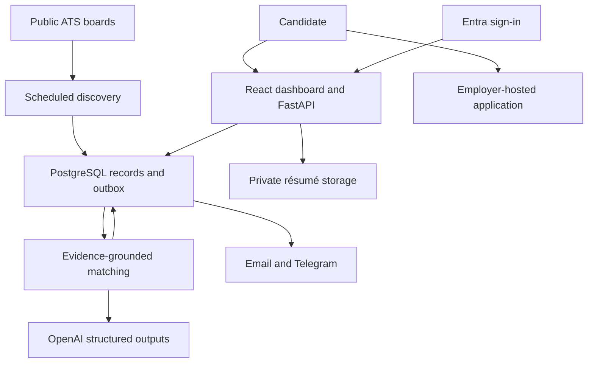

# AI International Job Hunter

Private international Azure job-search workspace with opt-in agentic discovery, OpenAI matching, sponsorship-evidence verification, and provider-authorized submission. The application is deployed on an isolated UK South Azure Container Instances stack.

## One-command Windows launch (Docker Desktop)

From Windows PowerShell, at the repository root:

```powershell
.\scripts\start-local.ps1
```

Open **http://localhost:8000**. Sign in with the generated `LOCAL_ACCESS_TOKEN` in the local, git-ignored `.env` file. A private Docker volume persists the database and résumé files, and the discovery worker runs every 30 minutes while the container is running. It starts with public employer Greenhouse and Lever sources in `config/public-boards.json`; their sponsorship status remains unverified until you review vacancy-specific evidence. An OpenAI key is **optional**: literal, source-backed matching works for free after you verify the candidate profile. To enable GenAI matching, add `OPENAI_API_KEY=...` to `.env` and restart the container.

This local workflow **does not connect to or change any AegisSOC resources**. Only loopback localhost port 8000 is exposed.

## UK South live application — 18 November 2026

- Dashboard: https://jobsai-uksouth-jyothibr17.uksouth.azurecontainer.io
- Only resource group `jobsai-uksouth-rg` is used. The App Service quota is zero in this subscription, so the live runtime is an independent UK South Azure Container Instances group, not AegisSOC's Container Apps environment.
- ACI uses an HTTPS reverse proxy, dedicated private Azure Blob/Azure Files storage, registry and managed identity. The worker runs every 30 minutes while the container is healthy. Restart policy is Always, but **uninterrupted 24/7 availability is not an SLA**.
- Job Hunter's user-managed OpenAI key is saved to its separate UK South Key Vault. ChatGPT Plus is not an OpenAI API key. Employer application API credentials are unrelated and must be separately authorized by the employer.
- Azure Container Instances, registry, storage, Key Vault operations, model tokens and other cloud services may incur charges. Set Azure cost alerts and OpenAI project budgets.
- Do not alter or reuse any AegisSOC or non-UK-South resources for this application. A previous Central US attempt remains separate; this deployment does not manage or delete it.

## Azure OpenAI deployment and quota status (verified 18 November 2026)

- Azure OpenAI resource `jobsaiuksouth17openai` was provisioned successfully in **UK South**, resource group `jobsai-uksouth-rg`.
- Azure Key Vault `jobsaiuksouth17kv` contains real Azure-issued `azure-openai-api-key` and `azure-openai-endpoint` secrets. The configured Job Hunter owner has Key Vault Secrets User access to this vault only.
- The UK South account lists GPT-4.1 mini (`2025-04-14`) as a regional Standard candidate, but the subscription has **0 / 0 TPM quota units**, so Azure returns `InsufficientQuota` when deploying capacity 1. No successful model deployment exists. **Do not claim live AI inference works yet.**
- The `azure-openai-deployment` secret will be created only after the model deploys. The application detects it and enables actual Azure OpenAI ranking automatically. It does not treat a stored API key by itself as proof of model readiness.
- To resolve: request regional Standard GPT-4.1 mini capacity in **UK South** in Microsoft Foundry Quota. Free-tier (Tier 0) subscriptions may be ineligible for increased quota; Azure may require upgrading billing. Do not change tiers or approve costs without reviewing them.
- After quota is granted, rerun <https://github.com/JyothiBR17/jobs/actions/workflows/uksouth-azure-ai.yml>; the workflow creates the regional model, records the deployment secret and runs a synthetic inference smoke test, without touching AegisSOC.
- Read-only status: <https://github.com/JyothiBR17/jobs/actions/workflows/uksouth-ai-status.yml>. Never paste or commit vault secret values.

## Autonomous applications: what works and what remains gated

1. In **Settings**, save verified professional facts and upload the actual résumé PDF. Never upload these files to the public repository.
2. In **Agentic Autopilot**, connect a project-scoped OpenAI API key once. The authenticated API writes it to the Job Hunter-only UK South Key Vault. The engine uses source-grounded structured model analysis; without a key it uses conservative literal-evidence matching and labels that mode.
3. In **Agentic Autopilot**, enter a real contact email, choose specific authorized employer boards, choose score and daily limits, explicitly authorize external submissions and enable the automation. Disabled is the default; no hidden employer applications occur before these conditions are met.
4. The worker discovers configured public ATS boards every 30 minutes and automatically excludes India and unclassified locations. Worldwide does **not** mean every employer or every job board is discoverable: add permitted named board integrations as needed.
5. The worker accepts sponsorship only when a posting itself contains explicit, non-negated visa-sponsorship language **and** clear evidence that international applicants (including those based in India) are considered. Employer licence-only matches are insufficient. Unknown sponsorship remains unverified.
6. **Actual automatic submission** is implemented for employer-authorized Lever/Lever EU boards with a confirmed standard form. Supply secret `LEVER_APPLY_KEYS_JSON` to the UK South production GitHub environment in this shape (replace all placeholders; do not commit secrets):

   ```json
   {"lever:employer-board":{"key":"employer-issued-API-key","standard_form_confirmed":true}}
   ```

   Applications submit a real candidate email and the original PDF. Only `{ok:true, applicationId:"..."}` is recorded as employer-confirmed. Requests requiring employer-specific questions, unsupported ATS forms, missing credentials, uncertain outcomes or CAPTCHA interaction remain in review. The agent **does not invent answers or bypass site safeguards**.
7. Every attempted application is idempotently reserved before the network request. Timeout outcomes become `unknown` and are never silently re-sent. The 24-hour confirmed limit is configurable (1–20). Approved or candidate-recorded submissions continue in the existing tracking workflow.

The app does **not** have unrestricted application-submission privileges across LinkedIn, Indeed, Workday, Greenhouse, Ashby or other employer systems. It does not claim that an exported draft is a submitted application. Further connector permissions, applicant-supplied screening facts and employer-side submission access are needed for greater coverage.

## Install and run locally

Use Python 3.12 and Node.js 22. Run from the project root.

```bash
python -m venv .venv
source .venv/bin/activate
pip install -r requirements.txt
npm --prefix web ci
npm --prefix web run build
export LOCAL_ACCESS_TOKEN="$(python -c 'import secrets; print(secrets.token_urlsafe(32))')"
export LOCAL_DB=demo.db
python -m app.demo
uvicorn app.api:app --host 127.0.0.1 --port 8000
```

Open http://127.0.0.1:8000 and use your local token. The demonstration vacancies have synthetic employers and reserved example.test URLs. Use a separate empty database for actual discovery. Set DATABASE_URL with a PostgreSQL DSN for parity with production. Migrations run on startup. The API and worker share the database. Python and npm dependencies are installed at build time.

## Architecture



Public ATS feeds run only for named employer boards. Discovery filters explicit India work locations and ambiguous or unclassified locations, then deduplicates by provider record and canonical URL. The review queue separates sponsorship evidence from model scoring. Match scores cite a role requirement and a stored candidate fact. Drafts quote facts verbatim. A changed posting, profile, sponsorship decision, answer, or excluded employer can invalidate approval. Approval uses a database transaction and exact draft revisions.

The deployment design uses one low-volume scheduled worker and a database outbox. The local Docker pilot uses persistent SQLite; PostgreSQL remains supported for a future dedicated production deployment. Service Bus queues are defined for a future transition. The worker does not publish to or consume from them.

## Operating guide

1. Save a candidate profile under Settings. Upload the original PDF. Review the facts and set source_verified to true. A private onboarding JSON can be imported in Settings. The profile is supplied to the model as selected work facts only, without sending the full PDF or contact details.
2. Configure JOB_BOARDS_JSON with permitted employer boards. Each entry specifies provider, slug and employer. Provider values are greenhouse, lever, lever-eu and ashby. Start small and document each board’s allowed use.
3. Optionally set OPENAI_API_KEY through your secure local environment or Azure Key Vault. Set OPENAI_MODEL to a supported structured-output model if changing the default. Run `python -m app.worker` to discover and score. Each run processes up to ten unscored jobs and prioritizes jobs never attempted. MAX_MONTHLY_MODEL_REQUESTS defaults to 1,000. Analytics reports attempted requests and returned token counts.
4. Review the Sponsorship Verification queue. Use the employer’s vacancy wording for vacancy sponsorship. Enable VERIFY_PUBLIC_REGISTRIES=yes for daily exact-name checks against the UK GOV.UK and Netherlands IND registers. Check the legal entity against the vacancy. Registry matches create licence-only evidence. Record the visa route, evidence URL and exact wording, and mark unknown values explicitly. The reviewer decides what the quote means. Licence-only and unknown records stay in review. Expired sponsorship evidence gates approval.
5. Prepare a draft from an eligible vacancy after recording sponsorship. Select the drafts to review. Preview the CV, cover letter and answers, then confirm the exact list. Open the employer-hosted form and manually submit. Record the employer confirmation reference and add interview or recruiter updates as they arrive.
6. To send aggregate daily counts, supply TELEGRAM_BOT_TOKEN and TELEGRAM_CHAT_ID or SMTP_HOST, SMTP_PORT (implicit TLS), SMTP_FROM, SMTP_TO, SMTP_USER and SMTP_PASSWORD. A mail relay that supports implicit TLS is required. Try first with an inbox/bot you control. Reports default to 7 p.m. in Asia/Kolkata, with a weekly digest on Sundays. Event alerts are queued for the next worker run. Verify safe delivery before enabling production notifications. Aggregate outbox delivery may repeat if a worker stops after provider acceptance and before the transaction commits.
7. Run `python -m unittest discover -s tests -v` for the local suite. Set TEST_POSTGRES_URL to a **disposable test database** to repeat against PostgreSQL. Tests truncate its tables.

## Security and operations

The Entra production configuration accepts v2 delegated access tokens for one tenant, the configured API audience, one owner object ID, and the access_as_user scope. Enforce MFA with your tenant’s policy and verify that login before accepting production traffic. Local bearer auth is intended for loopback use. The API rejects missing and mismatched credentials and sets a restrictive browser content policy. The UK South ACI pilot uses single-instance SQLite on private Azure Files storage; a higher-availability production release should move to managed PostgreSQL with tested backups and isolation. Review and enable ingress rate limiting with a suitable Azure edge control if deploying publicly.

Job advertisements are untrusted. The OpenAI model scores and drafts content but has no direct network write authority or permission to change sponsorship, approval or submission policy. A separate deterministic policy-enforcing orchestrator can perform explicitly authorized provider submissions. Score excerpts must exist in the source text. Human reviewers confirm sponsorship. The original PDF is kept separate from extracted professional facts. Avoid collecting identity documents, passport numbers, or legal declarations. The production release has an opt-in Lever/Lever EU application adapter, gated by employer-issued credentials, verified candidate facts, explicit candidate authorization and a real external confirmation. Sandbox submission tests require synthetic origins, an explicit policy, allowlisted employers and roles, resolved answers, an eligible vacancy, and a returned sandbox receipt.

## Troubleshooting

| Symptom | Check |
| --- | --- |
| No vacancies | Verify board identifiers, adapter, activity log and recognised work location. Worldwide or unclassified locations are held out of discovery. |
| Vacancies have no score | Verify the candidate profile, original PDF and worker execution. OpenAI model credentials are only required for GenAI ranking; free literal-evidence matching remains available. |
| High fit but ineligible | Review sponsor evidence, exclusions, vacancy activity and deadline. |
| Approval rejected | Refresh and inspect the draft revision, expiry, profile, and sponsorship state. |
| Missing notice | Check relay configuration and outbox attempts or dead state. |
| Entra sign-in fails | Register the exact UK South HTTPS root URL as a SPA redirect URI on the **Job Hunter** Entra app registration, without modifying AegisSOC. Verify audience, scope and tenant. |
| Azure worker fails | Inspect the isolated UK South Azure Container Instances app container logs, Key Vault role propagation, storage volume mounts and schedule settings. |

See [AZURE.md](AZURE.md) for cost, resource plan, permissions, deployment and release gaps.
