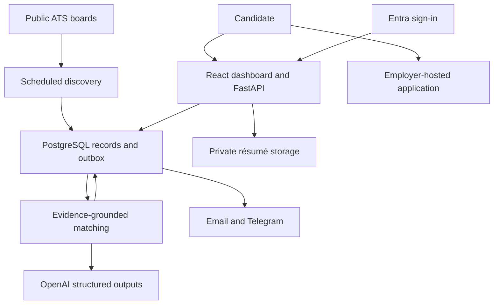

# AI International Job Hunter

Private international Azure job-search workspace. This repository contains a functional local pilot and isolated Azure deployment options. Live Azure hosting still depends on subscription quotas.

## One-command Windows launch (Docker Desktop)

From Windows PowerShell, at the repository root:

```powershell
.\scripts\start-local.ps1
```

Open **http://localhost:8000**. Sign in with the generated `LOCAL_ACCESS_TOKEN` in the local, git-ignored `.env` file. A private Docker volume persists the database and résumé files, and the discovery worker runs every 30 minutes while the container is running. It starts with public employer Greenhouse and Lever sources in `config/public-boards.json`; their sponsorship status remains unverified until you review vacancy-specific evidence. An OpenAI key is **optional**: literal, source-backed matching works for free after you verify the candidate profile. To enable GenAI matching, add `OPENAI_API_KEY=...` to `.env` and restart the container.

This local workflow **does not connect to or change any AegisSOC resources**. Only loopback localhost port 8000 is exposed.

## Azure deployment status — 18 November 2026

The dedicated `.github/workflows/job-hunter-appservice.yml` pipeline is scoped to `jobsai-rg` and requires an explicit manual run. Central US hosting could not be provisioned because Azure reports **zero B1 quota and zero F1 quota** for App Service. Azure also rejected the selected PostgreSQL Flexible Server SKU and rejected creating a second Container Apps environment. AegisSOC's existing environment is deliberately not used. Do **not** assume that a successful build means the app is live in Azure.

Once an F1 quota of 1 is granted, run the isolated App Service workflow. F1 is a testing tier without Always On, so its scheduled worker is best-effort; a production SLA requires a suitable approved hosting tier and a production database.

## Install and run locally

Use Python 3.12 and Node.js 22. Run from the project root.

```bash
python -m venv .venv
source .venv/bin/activate
pip install -r requirements.txt
npm --prefix web ci
npm --prefix web run build
export LOCAL_ACCESS_TOKEN="$(python -c 'import secrets; print(secrets.token_urlsafe(32))')"
export LOCAL_DB=demo.db
python -m app.demo
uvicorn app.api:app --host 127.0.0.1 --port 8000
```

Open http://127.0.0.1:8000 and use your local token. The demonstration vacancies have synthetic employers and reserved example.test URLs. Use a separate empty database for actual discovery. Set DATABASE_URL with a PostgreSQL DSN for parity with production. Migrations run on startup. The API and worker share the database. Python and npm dependencies are installed at build time.

## Architecture



Public ATS feeds run only for named employer boards. Discovery filters explicit India work locations and ambiguous or unclassified locations, then deduplicates by provider record and canonical URL. The review queue separates sponsorship evidence from model scoring. Match scores cite a role requirement and a stored candidate fact. Drafts quote facts verbatim. A changed posting, profile, sponsorship decision, answer, or excluded employer can invalidate approval. Approval uses a database transaction and exact draft revisions.

The deployment design uses one low-volume scheduled worker and a database outbox. The local Docker pilot uses persistent SQLite; PostgreSQL remains supported for a future dedicated production deployment. Service Bus queues are defined for a future transition. The worker does not publish to or consume from them.

## Operating guide

1. Save a candidate profile under Settings. Upload the original PDF. Review the facts and set source_verified to true. A private onboarding JSON can be imported in Settings. The profile is supplied to the model as selected work facts only, without sending the full PDF or contact details.
2. Configure JOB_BOARDS_JSON with permitted employer boards. Each entry specifies provider, slug and employer. Provider values are greenhouse, lever, lever-eu and ashby. Start small and document each board’s allowed use.
3. Optionally set OPENAI_API_KEY through your secure local environment or Azure Key Vault. Set OPENAI_MODEL to a supported structured-output model if changing the default. Run `python -m app.worker` to discover and score. Each run processes up to ten unscored jobs and prioritizes jobs never attempted. MAX_MONTHLY_MODEL_REQUESTS defaults to 1,000. Analytics reports attempted requests and returned token counts.
4. Review the Sponsorship Verification queue. Use the employer’s vacancy wording for vacancy sponsorship. Enable VERIFY_PUBLIC_REGISTRIES=yes for daily exact-name checks against the UK GOV.UK and Netherlands IND registers. Check the legal entity against the vacancy. Registry matches create licence-only evidence. Record the visa route, evidence URL and exact wording, and mark unknown values explicitly. The reviewer decides what the quote means. Licence-only and unknown records stay in review. Expired sponsorship evidence gates approval.
5. Prepare a draft from an eligible vacancy after recording sponsorship. Select the drafts to review. Preview the CV, cover letter and answers, then confirm the exact list. Open the employer-hosted form and manually submit. Record the employer confirmation reference and add interview or recruiter updates as they arrive.
6. To send aggregate daily counts, supply TELEGRAM_BOT_TOKEN and TELEGRAM_CHAT_ID or SMTP_HOST, SMTP_PORT (implicit TLS), SMTP_FROM, SMTP_TO, SMTP_USER and SMTP_PASSWORD. A mail relay that supports implicit TLS is required. Try first with an inbox/bot you control. Reports default to 7 p.m. in Asia/Kolkata, with a weekly digest on Sundays. Event alerts are queued for the next worker run. Verify safe delivery before enabling production notifications. Aggregate outbox delivery may repeat if a worker stops after provider acceptance and before the transaction commits.
7. Run `python -m unittest discover -s tests -v` for the local suite. Set TEST_POSTGRES_URL to a **disposable test database** to repeat against PostgreSQL. Tests truncate its tables.

## Security and operations

The Entra production configuration accepts v2 delegated access tokens for one tenant, the configured API audience, one owner object ID, and the access_as_user scope. Enforce MFA with your tenant’s policy and verify that login before accepting production traffic. Local bearer auth is intended for loopback use. The API rejects missing and mismatched credentials and sets a restrictive browser content policy. The dedicated App Service pilot can explicitly opt in to single-instance SQLite on persistent /home storage; full production should use PostgreSQL and private Blob storage. Review and enable ingress rate limiting with a suitable Azure edge control if deploying publicly.

Job advertisements are untrusted. The model has no tools or write access and cannot change sponsorship, approval, or submission policy. Score excerpts must exist in the source text. Human reviewers confirm sponsorship. The original PDF is kept separate from extracted professional facts. Avoid collecting identity documents, passport numbers, or legal declarations. The release contains no live outbound ATS adapter. Sandbox submission tests require synthetic origins, an explicit policy, allowlisted employers and roles, resolved answers, an eligible vacancy, and a returned sandbox receipt.

## Troubleshooting

| Symptom | Check |
| --- | --- |
| No vacancies | Verify board identifiers, adapter, activity log and recognised work location. Worldwide or unclassified locations are held out of discovery. |
| Vacancies have no score | Verify the candidate profile, original PDF and worker execution. OpenAI model credentials are only required for GenAI ranking; free literal-evidence matching remains available. |
| High fit but ineligible | Review sponsor evidence, exclusions, vacancy activity and deadline. |
| Approval rejected | Refresh and inspect the draft revision, expiry, profile, and sponsorship state. |
| Missing notice | Check relay configuration and outbox attempts or dead state. |
| Entra sign-in fails | Review redirect URI, token version, audience, delegated scope, owner object ID and tenant policy. |
| Azure worker fails | Inspect Container Apps Job execution logs, Key Vault role propagation, DSN TLS and private DNS. |

See [AZURE.md](AZURE.md) for cost, resource plan, permissions, deployment and release gaps.
